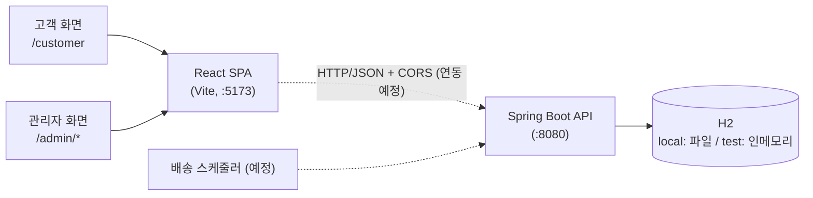

# ☕ 카페 원두 주문 서비스 (NBE14-16-1-team2)

회원가입 없이 이메일만으로 원두를 주문하고, 관리자가 상품과 주문·배송 상태를 관리하는 웹 서비스입니다.

> **현재 단계: 환경 세팅 완료 (초기 환경 구성, 공통 응답·예외 처리·CORS) · 공통 엔티티 구성(WBS 2.4) 리뷰 전**
> 이 문서의 비즈니스 규칙·ERD·API 목록은 **후속 개발 기준**입니다. 상품·주문 업무 API는 아직 구현되지 않았습니다.
> 지금까지 구현된 것은 [3. 주요 기능과 구현 현황](#3-주요-기능과-구현-현황)에서 ✅로 표시한 항목뿐입니다.

## 📌 목차

1. [프로젝트 소개](#1-프로젝트-소개)
2. [핵심 비즈니스 규칙](#2-핵심-비즈니스-규칙)
3. [주요 기능과 구현 현황](#3-주요-기능과-구현-현황)
4. [기술 스택](#4-기술-스택)
5. [시스템 구성](#5-시스템-구성)
6. [ERD 및 설계 의도](#6-erd-및-설계-의도)
7. [API·응답 정책](#7-api응답-정책)
8. [실제 프로젝트 구조](#8-실제-프로젝트-구조)
9. [팀 구성 및 역할](#9-팀-구성-및-역할)
10. [협업 규칙](#10-협업-규칙)
11. [일정](#11-일정)
12. [심화 과제](#12-심화-과제)
13. [실행·검증 방법](#13-실행검증-방법)
14. [남은 결정 사항](#14-남은-결정-사항)

---

## 1. 프로젝트 소개

| 항목 | 내용 |
|---|---|
| 서비스 | 카페 원두 온라인 주문 서비스 |
| 고객 | 회원가입 없이 이메일·주소·우편번호를 입력해 원두를 주문 |
| 관리자 | 원두 상품 등록·수정·삭제, 배송 그룹별 주문 확인 |
| 저장소 구성 | `backend/` (Spring Boot API 서버), `frontend/` (React SPA) |

> 문서 간 내용이 충돌하면 **최신 팀 확정 정책**을 우선합니다.

---

## 2. 핵심 비즈니스 규칙

> 아래 규칙은 팀 확정 정책이며 **아직 구현되지 않았습니다.** 미확정 부분은 [14. 남은 결정 사항](#14-남은-결정-사항)에 따로 적었습니다.

### 2-1. 고객 구분
- 회원가입·로그인 없이 **이메일**로 고객을 구분합니다.

### 2-2. 배송 그룹과 주문 병합
- 주문 시각(`ordered_at`)의 **오후 2시** 기준으로 배송 예정일(`delivery_date`)을 계산해 주문 시점에 저장합니다.
- 같은 고객(이메일)이 같은 배송 그룹에 넣은 주문은 병합 대상입니다.
- **주소가 다른 주문은 병합하지 않고 별도 주문**으로 저장합니다.

### 2-3. 주문 상태와 배송 스케줄러

```
ORDERED ──(매일 14:30, 배송 예정일이 오늘인 주문)──▶ SHIPPING ──(배송 시작일 다음 날 14:30)──▶ DELIVERED
   │
   └──▶ CANCELLED (ORDERED 상태에서만 전환 가능, 이후 상태 변경 없음)
```

| 상태 | 의미 | 전환 |
|---|---|---|
| `ORDERED` | 주문 접수 (기본값) | 주문 생성 시 |
| `SHIPPING` | 배송 중 | 매일 14:30 스케줄러가 `ORDERED`이면서 배송 예정일이 오늘인 주문을 일괄 전환 |
| `DELIVERED` | 배송 완료 | 배송 시작일 **다음 날 14:30** 스케줄러가 일괄 전환 |
| `CANCELLED` | 주문 취소 | `ORDERED` 상태에서만 가능 |

### 2-4. 취소 정책
- **고객의 주문 취소는 허용하지 않습니다.**
- **병합된 주문의 일부 상품만 취소하는 것은 허용하지 않습니다.**
- API 명세 기준 관리자의 수동 상태 변경은 **`ORDERED` → `CANCELLED`만** 가능합니다.
- API 명세 기준 관리자 주문 수정 대상은 **주소·우편번호·수량**입니다.
- 관리자가 **어떤 상태에서** 주문을 수정·전체 취소할 수 있는지는 미확정입니다.

### 2-5. 상품 삭제와 주문 스냅샷
- 상품은 행을 지우지 않고 `is_deleted` 플래그로 **논리 삭제**합니다.
- 주문 상세(`order_item`)에는 **주문 당시 상품명과 단가**를 복사해 저장합니다. 이후 상품 이름이나 가격이 바뀌어도 과거 주문 내역은 변하지 않습니다.

### 2-6. 시간 기준
- 모든 시간 계산은 **Asia/Seoul** 기준입니다. (백엔드 JVM 기본 시간대와 Hibernate JDBC 시간대를 Asia/Seoul로 설정해 둠)

---

## 3. 주요 기능과 구현 현황

상태: ✅ 완료(머지됨) · 🟨 구현·테스트 통과, 리뷰·머지 전 · ⬜ 예정

### 환경 세팅

| 항목 | 상태 |
|---|---|
| Spring Boot 프로젝트 생성 (Java 21, Gradle Wrapper) | ✅ |
| JPA + H2 연결 (local: 파일 DB, test: 인메모리 DB) | ✅ |
| 테스트 전용 엔티티로 JPA 저장·조회 통합 테스트 | ✅ |
| `product` / `order` / `global` 패키지 골격 | ✅ |
| React + Vite 프로젝트 생성 | ✅ |
| 기본 라우팅 (`/customer`, `/admin/products`, `/admin/orders`, `/` → `/customer`, 404) | ✅ |
| 공통 레이아웃·내비게이션 | ✅ |
| 공통 오류 응답(`code`/`message`)·공통 예외 처리 | ✅ |
| `/api/**` CORS 설정 | ✅ |
| 공통 엔티티 `Product`·`Order`·`OrderItem`, 상품 생성·수정일 JPA Auditing | 🟨 |

### 고객 기능

| 기능 | 상태 |
|---|---|
| 원두 상품 목록 조회 | ⬜ |
| 이메일·주소·우편번호로 주문 생성 | ⬜ |
| 배송 그룹 계산(오후 2시 기준)과 주문 병합 | ⬜ |

### 관리자 기능

| 기능 | 상태 |
|---|---|
| 상품 등록·수정·논리 삭제 | ⬜ |
| 주문 목록 조회 | ⬜ |
| 배송 상태 자동 전환 스케줄러 | ⬜ |
| 관리자 인증 | ⬜ (방식 미확정) |

### 공통

| 기능 | 상태 |
|---|---|
| 프론트·백엔드 API 연동 (브라우저에서 실제 API 호출) | ⬜ (CORS만 설정됨, 연동 미확인) |

> ⚠️ 현재 `/admin/*` 화면은 **URL로 화면만 구분**할 뿐 인증·권한 검사가 없습니다. 누구나 접근할 수 있습니다.

---

## 4. 기술 스택

실제로 프로젝트에 적용된 버전입니다.

| 구분 | 기술 | 버전 |
|---|---|---|
| Language | Java | 21 (Gradle toolchain, 검증 환경: Eclipse Temurin 21.0.13) |
| Framework | Spring Boot | 4.2.0 (Spring Framework 7.1.0) |
| Build | Gradle Wrapper | 9.9.2 |
| ORM | Spring Data JPA / Hibernate ORM | 4.2.0 / 7.4.15.Final |
| Validation | Hibernate Validator | 9.1.6.Final |
| Database | H2 | 2.5.252 |
| 기타 | Lombok | 1.18.48 |
| Test | JUnit Jupiter (spring-boot-starter-*-test) | 6.1.3 |
| Frontend | React / React DOM | 19.3.1 |
| Build Tool | Vite (@vitejs/plugin-react) | 8.3.8 (6.3.0) |
| Routing | React Router (`react-router`) | 8.5.3 |
| Lint | oxlint | 1.95.0 |
| Runtime | Node.js | 22.22 이상 필요 (검증 환경: 26.13.0, npm 11.20.0) |

MySQL·Docker·Redis는 사용하지 않습니다.

---

## 5. 시스템 구성



| 계층 | 역할 |
|---|---|
| Controller | 요청 검증(Validation), 실제 DTO 반환 (예정) |
| Service | 배송 그룹 계산, 주문 병합, 상태 전환 등 비즈니스 규칙. 업무 오류는 `BusinessException` (예정) |
| Repository | Spring Data JPA로 DB 접근 (운영 Repository는 아직 없음) |
| Entity | `product.Product`, `order.Order`, `order.OrderItem` ([6-1](#6-1-구현된-엔티티)) |
| DB | H2 (local 프로필은 `backend/data/`의 파일 DB) |
| global/error | `GlobalExceptionHandler`가 모든 예외를 `code`/`message` 오류 응답으로 변환 |
| global/config | `/api/**` CORS 설정, JPA Auditing(Asia/Seoul `Clock`) |

> `/api/**` CORS는 설정했지만, 프론트에서 실제 API를 호출하는 **연동은 아직 하지 않았습니다.**

---

## 6. ERD 및 설계 의도

> 아래 테이블은 ERD 설계 기준입니다. 이를 구현한 JPA 엔티티는 [6-1. 구현된 엔티티](#6-1-구현된-엔티티)에 정리했습니다.


- `orders` 1:N `order_item` (`order_id` FK, 삭제 규칙 CASCADE)
- `product` 1:N `order_item` (`product_id` FK, 삭제 규칙 RESTRICT)

### product

| 컬럼 | 타입 | 제약 | 설명 |
|---|---|---|---|
| `product_id` | bigint | PK, 자동 증가 | 상품 ID |
| `product_name` | varchar(100) | 필수 | 상품 이름 |
| `price` | int | 필수 | 1개당 가격 (원 단위 정수) |
| `description` | text | | 상품 설명 |
| `origin` | enum | 필수 | `COLOMBIA`, `BRAZIL`, `ETHIOPIA`, `OTHER` |
| `image_path` | varchar(255) | | 이미지 경로 |
| `created_at` | datetime | 필수 | 생성일시 |
| `updated_at` | datetime | 필수 | 수정일시 |
| `is_deleted` | bool | 필수 | 논리 삭제 여부 |

### orders

| 컬럼 | 타입 | 제약 | 설명 |
|---|---|---|---|
| `order_id` | bigint | PK, 자동 증가 | 주문 ID |
| `email` | varchar(255) | 필수 | 고객 이메일 (고객 구분 기준) |
| `address` | varchar(255) | 필수 | 배송 주소 |
| `zipcode` | varchar(10) | 필수 | 우편번호 (앞자리 0 보존을 위해 문자열) |
| `ordered_at` | datetime | 필수 | 주문 시각 (오후 2시 기준 판단용) |
| `status` | enum | 필수, 기본 `ORDERED` | `ORDERED`, `SHIPPING`, `DELIVERED`, `CANCELLED` |
| `delivery_date` | date | 필수 | 배송 예정일 (주문 시점에 계산해 저장) |

### order_item

| 컬럼 | 타입 | 제약 | 설명 |
|---|---|---|---|
| `order_item_id` | bigint | PK, 자동 증가 | 주문 상세 ID |
| `order_id` | bigint | FK → `orders`, 필수 | 소속 주문 |
| `product_id` | bigint | FK → `product`, 필수 | 주문 상품 |
| `product_name` | varchar(100) | 필수 | **주문 당시** 상품 이름 |
| `quantity` | int | 필수 | 주문 수량 |
| `order_price` | int | 필수 | **주문 당시** 단가 |

### 설계 의도

- **테이블 이름 `orders`**: `ORDER`는 SQL 예약어라 복수형을 사용합니다.
- **주문 당시 값 스냅샷**: `order_item.product_name`, `order_price`를 따로 저장해 상품 정보가 바뀌어도 주문 내역이 유지됩니다.
- **배송 예정일 저장**: 오후 2시 기준 계산 결과를 `delivery_date`에 저장해, 배송 그룹 조회와 스케줄러 전환을 이 컬럼으로 처리합니다.
- **상품 논리 삭제**: `is_deleted`로 숨기고 행은 남겨, 과거 주문이 참조하는 상품을 보존합니다. (API 명세의 `is_delete` 표기와 통일 필요 → [14-2](#14-2-명세-보완-필요-사항))

### 주문 취소 ≠ 주문 행 물리 삭제

| 구분 | 의미 | 데이터 변화 |
|---|---|---|
| **주문 취소** (업무 기능) | 주문 상태를 `CANCELLED`로 변경 | `orders`·`order_item` 행은 **그대로 남음** |
| **주문 행 물리 삭제** (DB 규칙) | `orders` 행을 `DELETE` | FK `ON DELETE CASCADE`로 해당 `order_item`도 함께 삭제 |

- 주문 취소는 행을 지우지 않습니다. CASCADE는 **데이터 정리 등으로 주문 행 자체를 지울 때만** 적용되는 물리 규칙입니다.
- `order_item.product_id`는 `ON DELETE RESTRICT`입니다. 주문에 쓰인 상품 행은 물리 삭제할 수 없으며, 상품 삭제 기능은 `is_deleted` 플래그로 처리합니다.

### 6-1. 구현된 엔티티

> WBS 2.4. 엔티티·테스트만 구현했고, 이를 사용하는 Repository·Service·API는 아직 없습니다.

| 엔티티 | 패키지 | 테이블 | 필드 → 컬럼 |
|---|---|---|---|
| `Product` | `product` | `product` | `id`→`product_id`, `productName`→`product_name`(100), `price`, `description`→`description`(TEXT), `origin`(문자열 enum), `imagePath`→`image_path`(255), `createdAt`→`created_at`, `updatedAt`→`updated_at`, `isDeleted`→`is_deleted` |
| `Order` | `order` | `orders` | `id`→`order_id`, `email`(255), `address`(255), `zipcode`(10), `orderedAt`→`ordered_at`, `status`(문자열 enum), `deliveryDate`→`delivery_date` |
| `OrderItem` | `order` | `order_item` | `id`→`order_item_id`, `order`→`order_id`, `product`→`product_id`, `productName`→`product_name`(100), `quantity`, `orderPrice`→`order_price` |
| `Origin` | `product` | — | `COLOMBIA`, `BRAZIL`, `ETHIOPIA`, `OTHER` |
| `OrderStatus` | `order` | — | `ORDERED`, `SHIPPING`, `DELIVERED`, `CANCELLED` |

필수 여부·길이는 ERD와 같습니다. (`description`, `image_path`만 nullable)

#### 연관관계와 삭제 규칙

| 관계 | JPA 매핑 | JPA cascade | DB FK 삭제 규칙 |
|---|---|---|---|
| `OrderItem` → `Order` | `@ManyToOne(LAZY, optional=false)`, `@JoinColumn(order_id, nullable=false)` — **연관관계 주인** | 없음 | `ON DELETE CASCADE` (`@OnDelete(CASCADE)`) |
| `Order` → `orderItems` | `@OneToMany(mappedBy="order")`, 읽기 전용 목록 반환 | `PERSIST`만 | — |
| `OrderItem` → `Product` | `@ManyToOne(LAZY, optional=false)`, `@JoinColumn(product_id, nullable=false)` | 없음 | `ON DELETE RESTRICT` (`@OnDelete(RESTRICT)`) |
| `Product` → 주문 상세 | 만들지 않음 (불필요한 양방향 관계 제외) | — | — |

- **JPA cascade와 DB 삭제 규칙은 별개입니다.** JPA cascade는 애플리케이션이 엔티티를 저장·삭제할 때 연관 엔티티에 작업을 전파하는 것이고, `ON DELETE`는 DB에서 행을 지울 때 FK가 어떻게 반응하는지입니다.
- `PERSIST`만 켠 이유: 주문 생성 시 상세를 함께 저장해야 하기 때문입니다.
- `REMOVE`·`orphanRemoval`을 켜지 않은 이유: 고객 취소·부분 취소가 허용되지 않고 주문 DELETE 의미도 미확정이라, 상세를 애플리케이션에서 지울 경로가 없습니다. 주문 행을 물리 삭제할 경우의 상세 정리는 DB `ON DELETE CASCADE`가 담당합니다.
- `Product` 쪽으로는 cascade를 전파하지 않습니다. 주문을 지우거나 취소해도 상품은 영향받지 않습니다.

#### 스냅샷·논리 삭제·Auditing·금액 계산

| 항목 | 구현 | 비고 |
|---|---|---|
| 주문 상세 추가 | `order.add_order_item(product, quantity)` — 컬렉션과 `OrderItem.order`를 함께 설정 | 상세 목록은 외부에서 수정 불가 |
| 스냅샷 | 상세 생성 시 `Product`의 현재 `productName`·`price`를 `productName`·`orderPrice`로 복사 | 이후 상품 이름·가격이 바뀌어도 상세 값은 그대로 |
| 상품 논리 삭제 | `product.mark_deleted()` → `is_deleted = true` | 복구 기능 없음. 기존 주문 상세의 상품 참조 유지 |
| 삭제 상품 제외 | **전역 필터를 쓰지 않음** | 고객 상품 조회·주문 생성에서 `isDeleted = false` 조건을 **직접** 걸어야 함 (후속 작업) |
| 상품 정보 수정 | `product.update_info(...)` | 관리자 상품 수정용 |
| 생성·수정일 | `Product`만 JPA Auditing(`@CreatedDate`, `@LastModifiedDate`), `Clock`은 Asia/Seoul | `Order`에는 ERD에 없는 생성·수정일 컬럼을 두지 않음 |
| 항목 금액 | `orderItem.calculate_amount()` = `(long) orderPrice × quantity` | 곱하기 전에 `long`으로 변환해 int 오버플로 방지 |
| 주문 총액 | `order.calculate_total_amount()` = 항목 금액 합계 (`long`) | 합계 컬럼 없음, 상품의 현재 가격을 쓰지 않음 |
| 신규 기본값 | 상품 `isDeleted = false`, 주문 `status = ORDERED` | 생성 시 Java에서 설정 |
| 입력 조건 | 가격·수량은 1 이상, 필수 문자열·값 누락 금지 | 위반 시 `BusinessException(INVALID_INPUT)` → API에서는 400 |
| 주문 시각·배송 예정일 | 생성 시 외부에서 전달 | 14시 기준 배송일 계산은 아직 없음 |
| 상태 전환 | **메서드 없음** | 취소·배송 전환 규칙 확정 후 추가 |

#### ERD와 실제 스키마 차이 (H2 자동 생성 기준)

| 항목 | ERD | 실제 스키마 | 영향 |
|---|---|---|---|
| `description` 타입 | `text` | H2에서 `CHARACTER VARYING(1000000000)` (`TEXT` 지정) | 기능 차이 없음 |
| `origin`·`status` 타입 | enum | H2 `ENUM` 타입 (Hibernate가 생성) | `ddl-auto=update`는 기존 ENUM 컬럼에 **새 값을 추가하지 않음**. enum 값을 늘리면 local DB 컬럼을 직접 변경해야 함 |
| `status` 기본값 | `default: 'ORDERED'` | DB 기본값 없음 | 엔티티 생성 시 Java에서 `ORDERED` 설정. SQL로 직접 넣으면 기본값이 적용되지 않음 |
| 가격·수량 양수 | (명시 없음) | DB CHECK 제약 없음 | 엔티티 생성·수정 시 애플리케이션에서 검사 |
| `datetime` / `bool` | `datetime` / `bool` | `TIMESTAMP` / `BOOLEAN` | H2 대응 타입 |

---

## 7. API·응답 정책

### 7-1. 전체 API

API 명세 기준 상품 5개, 주문 6개입니다. **11개 모두 아직 구현되지 않았습니다.**
요청·응답 필드는 명세가 완성되지 않아 **모두 미확정**입니다. ([14-2. 명세 보완 필요 사항](#14-2-명세-보완-필요-사항) 참고)

| 구분 | 기능 | 사용자 | Method | URL | 성공 코드 | 설명 | 구현 상태 | 상세 명세 링크 |
|---|---|---|---|---|---|---|---|---|
| 상품 | 상품 목록 조회 | 고객 | `GET` | `/api/products` | 200 | 상품 목록 조회 · 요청·응답 미확정 | ⬜ 미구현 | — |
| 상품 | 상품 상세 조회 | 고객 | `GET` | `/api/products/{productId}` | 200 | 상품 1건 조회 · 요청·응답 미확정 | ⬜ 미구현 | — |
| 상품 | 상품 등록 | 관리자 | `POST` | `/api/admin/products` | 201 | 상품 등록 · 요청·응답 미확정 | ⬜ 미구현 | — |
| 상품 | 상품 수정 | 관리자 | `PUT` | `/api/admin/products/{productId}` | 200 | 상품 수정 · 요청·응답 미확정 | ⬜ 미구현 | — |
| 상품 | 상품 삭제 | 관리자 | `DELETE` | `/api/admin/products/{productId}` | 204 | 실제 삭제 대신 삭제 플래그 수정 | ⬜ 미구현 | — |
| 주문 | 주문 생성 | 고객 | `GET` ⚠️ | `/api/orders` | 201 | 장바구니에서 주문 생성 · **Method 확인 필요** · 요청·응답 미확정 | ⬜ 미구현 | — |
| 주문 | 주문 목록 조회 | 관리자 | `GET` | `/api/admin/orders` | 200 | 관리자 주문 목록 · 요청·응답 미확정 | ⬜ 미구현 | — |
| 주문 | 주문 상세 조회 | 관리자 | `GET` | `/api/admin/orders/{orderId}` | 200 | 관리자 주문 1건 조회 · 요청·응답 미확정 | ⬜ 미구현 | — |
| 주문 | 주문 수정 | 관리자 | `PUT` | `/api/admin/orders/{orderId}` | 200 | 주소·우편번호·수량 수정 (허용 상태 미확정) | ⬜ 미구현 | — |
| 주문 | 주문 상태 변경 | 관리자 | `PUT` | `/api/admin/orders/{orderId}/status` | 200 | 수동 변경은 `ORDERED` → `CANCELLED`만 | ⬜ 미구현 | — |
| 주문 | 주문 삭제 | 관리자 | `DELETE` | `/api/admin/orders/{orderId}` | 204 | 삭제 방식·허용 상태 **확인 필요** | ⬜ 미구현 | — |

- 상세 명세 링크는 확인된 링크가 없어 비워 두었습니다.
- `/admin` 경로는 화면·API 구분일 뿐이며 **관리자 인증은 아직 없습니다.**
- 장바구니 화면 이동은 React 라우팅·프론트 state의 역할이고, `/api/orders`는 주문 생성만 담당하도록 구분합니다.

### 7-2. 공통 응답

`success`/`data` 같은 **성공 래퍼를 쓰지 않습니다.** 컨트롤러는 실제 DTO(또는 목록)를 그대로 반환하고, 상태 코드로 결과를 구분합니다. JSON 필드명은 **camelCase**입니다.

| 상황 | HTTP 상태 | 본문 형식 | 예시 |
|---|---|---|---|
| 조회·수정 성공 | `200 OK` | 실제 DTO 또는 DTO 배열 | `{"productId":1,"productName":"콜롬비아 원두"}` / `[{...},{...}]` |
| 생성 성공 | `201 Created` | 생성된 DTO | `{"productId":10,"productName":"에티오피아 원두"}` |
| 삭제 성공 | `204 No Content` | 본문 없음 | (빈 본문) |
| 오류 | 4xx·5xx | `code`, `message` 두 필드만 | `{"code":"PRODUCT_NOT_FOUND","message":"상품을 찾을 수 없습니다."}` |

컨트롤러 작성 예시

```java
@GetMapping("/api/products/{productId}")
public ProductResponse get_product(@PathVariable Long productId) {           // 200 + DTO
    return productService.get_product(productId);
}

@PostMapping("/api/admin/products")
public ResponseEntity<ProductResponse> create_product(@Valid @RequestBody ProductCreateRequest request) {
    return ResponseEntity.status(HttpStatus.CREATED).body(productService.create_product(request)); // 201
}

@DeleteMapping("/api/admin/products/{productId}")
public ResponseEntity<Void> delete_product(@PathVariable Long productId) {
    productService.delete_product(productId);
    return ResponseEntity.noContent().build();                                  // 204, 빈 본문
}

// 서비스에서 업무 오류
throw new BusinessException(ErrorCode.PRODUCT_NOT_FOUND);                       // 404 + code/message
```

> 위 코드는 **사용 방법 예시**이며, `ProductResponse` 등 상품 클래스는 아직 없습니다.

### 7-3. 공통 예외 처리

구현 위치: `backend/src/main/java/com/cafe/beanorder/global/error/`

| 클래스 | 역할 |
|---|---|
| `ErrorResponse` | 오류 본문 `{ code, message }` (record) |
| `ErrorCode` | 오류 코드별 HTTP 상태·기본 메시지 (enum, `code` = enum 이름) |
| `BusinessException` | 업무 오류 표현 (`ErrorCode` 보유) |
| `GlobalExceptionHandler` | `@RestControllerAdvice`. Spring MVC 표준 예외는 `ResponseEntityExceptionHandler`를 상속해 **원래 상태 코드를 유지**하고 본문만 `code`/`message`로 변환 |

| 발생 상황 | 예외 또는 처리 지점 | HTTP 상태 | 오류 코드 | 검증 여부 |
|---|---|---|---|---|
| 요청 DTO 검증 실패 (`@Valid @RequestBody`) | `MethodArgumentNotValidException` → `handleMethodArgumentNotValid` | 400 | `INVALID_INPUT` | ✅ MockMvc |
| 잘못된 JSON | `HttpMessageNotReadableException` → `handleHttpMessageNotReadable` | 400 | `INVALID_INPUT` | ✅ MockMvc |
| 필수 요청 본문 누락 | `HttpMessageNotReadableException` → `handleHttpMessageNotReadable` | 400 | `INVALID_INPUT` | ✅ MockMvc |
| 경로 변수·파라미터 타입 오류 | `MethodArgumentTypeMismatchException` → `handleTypeMismatch` | 400 | `INVALID_INPUT` | ✅ MockMvc |
| 필수 파라미터 누락 | `MissingServletRequestParameterException` → `handleMissingServletRequestParameter` | 400 | `INVALID_INPUT` | ✅ MockMvc |
| 메서드 파라미터 검증 실패 (`@RequestParam @Min` 등) | `HandlerMethodValidationException` → `handleHandlerMethodValidationException` | 400 | `INVALID_INPUT` | ✅ MockMvc |
| 서비스 계층 검증 실패 (`@Validated`) | `ConstraintViolationException` → `handle_constraint_violation` | 400 | `INVALID_INPUT` | ✅ MockMvc |
| 존재하지 않는 상품·주문 | `BusinessException` → `handle_business_exception` | 404 | `PRODUCT_NOT_FOUND` 등 | ✅ MockMvc |
| 업무 상태 충돌 | `BusinessException` → `handle_business_exception` | 409 | `ORDER_STATUS_CONFLICT` 등 | ✅ MockMvc |
| 지원하지 않는 HTTP 메서드 | `HttpRequestMethodNotSupportedException` (상위 클래스) | 405 (`Allow` 헤더 유지) | `METHOD_NOT_ALLOWED` | ✅ MockMvc |
| 지원하지 않는 Content-Type | `HttpMediaTypeNotSupportedException` (상위 클래스) | 415 | `UNSUPPORTED_MEDIA_TYPE` | ✅ MockMvc |
| 없는 API 경로 | `NoResourceFoundException` (상위 클래스) | 404 | `RESOURCE_NOT_FOUND` | ✅ MockMvc·실제 서버 |
| 지원하지 않는 Accept | `HttpMediaTypeNotAcceptableException` (상위 클래스) | 406 | `NOT_ACCEPTABLE` | ⬜ 미검증 |
| 그 밖의 Spring MVC 표준 예외 | 상위 클래스 → `handleExceptionInternal` | 원래 상태 유지 | 400은 `INVALID_INPUT`, 5xx는 `INTERNAL_SERVER_ERROR`, 그 외는 HTTP 상태 이름 | ⬜ 미검증 |
| 예상하지 못한 서버 오류 | `Exception` → `handle_unexpected_exception` | 500 | `INTERNAL_SERVER_ERROR` | ✅ MockMvc (로그 기록, 상세 미노출) |

- 입력 오류 `message`는 `필드명: 검증 메시지` 형식이며, 여러 개면 쉼표로 이어 붙입니다. (예: `itemName: <검증 메시지>, quantity: <검증 메시지>`) 기본 검증 메시지는 서버 JVM 언어 설정을 따르므로, 고정 문구가 필요하면 DTO 어노테이션에 `message`를 지정합니다.
- 500 응답은 일반 메시지만 반환하고, 원인과 스택 트레이스는 **서버 로그에만** 남깁니다. SQL·비밀번호·내부 클래스명은 응답에 나오지 않습니다.
- CORS로 거부된 요청(403)은 예외 처리기를 거치지 않으므로 `code`/`message` 형식이 아닙니다.
- `fieldErrors` 등 추가 필드는 사용하지 않습니다.

오류 코드

| 코드 | HTTP 상태 | 기본 메시지 | 확정 여부 |
|---|---|---|---|
| `INVALID_INPUT` | 400 | 요청 값이 올바르지 않습니다. | 확정 (팀 요청) |
| `PRODUCT_NOT_FOUND` | 404 | 상품을 찾을 수 없습니다. | 확정 (팀 정책 예시) |
| `RESOURCE_NOT_FOUND` | 404 | 요청한 리소스를 찾을 수 없습니다. | 제안 (없는 URL용) |
| `METHOD_NOT_ALLOWED` | 405 | 지원하지 않는 HTTP 메서드입니다. | 제안 |
| `NOT_ACCEPTABLE` | 406 | 요청한 응답 형식을 지원하지 않습니다. | 제안 |
| `UNSUPPORTED_MEDIA_TYPE` | 415 | 지원하지 않는 Content-Type 입니다. | 제안 |
| `INTERNAL_SERVER_ERROR` | 500 | 서버 내부 오류가 발생했습니다. 잠시 후 다시 시도해 주세요. | 제안 |
| `ORDER_NOT_FOUND` | 404 | 주문을 찾을 수 없습니다. | **제안 (팀 확정 전)** |
| `ORDER_STATUS_CONFLICT` | 409 | 현재 주문 상태에서는 요청을 처리할 수 없습니다. | **제안 (팀 확정 전)** |

### 7-4. CORS 설정

구현 위치: `global/config/CorsConfig.java`, `global/config/CorsProperties.java`

| 항목 | 개발 기본값 | 설정 변경 방법 |
|---|---|---|
| 허용 Origin | `http://localhost:5173`, `http://127.0.0.1:5173` | 환경변수 `CORS_ALLOWED_ORIGINS`(쉼표 구분)로 **목록 전체를 교체**. 기본값은 `application.properties`의 `app.cors.allowed-origins` |
| 적용 경로 | `/api/**` | `CorsConfig` 코드 수정 |
| 허용 메서드 | `GET`, `POST`, `PUT`, `DELETE`, `OPTIONS` | `CorsConfig` 코드 수정 |
| 허용 요청 헤더 | `Content-Type` | `CorsConfig` 코드 수정 |
| credentials | 비활성화 (`Access-Control-Allow-Credentials` 미전송) | 쿠키 인증 도입 시 재검토 |
| preflight 캐시 | 3600초 | `CorsConfig` 코드 수정 |
| 와일드카드 `*` | 사용 불가 (`*` 포함 시 서버 기동 실패) | — |

배포 주소 추가 예시 (PowerShell, 기본값을 대체하므로 개발 주소도 함께 적음)

```powershell
$env:CORS_ALLOWED_ORIGINS = "http://localhost:5173,http://127.0.0.1:5173,https://<배포주소>.vercel.app"
.\gradlew.bat bootRun
```

> ⚠️ **CORS는 인증·권한 검사가 아닙니다.** 브라우저가 다른 출처의 응답을 읽어도 되는지만 정하는 규칙이며, curl·Postman 같은 비브라우저 요청은 막지 않습니다. 관리자 API 보호는 별도의 관리자 인증(미확정)으로 해결해야 합니다.

---

## 8. 실제 프로젝트 구조

```
.
├── .github/
│   └── pull_request_template.md
├── backend/
│   ├── build.gradle / settings.gradle
│   ├── gradlew / gradlew.bat / gradle/wrapper/   # Gradle Wrapper 9.9.2
│   ├── config/
│   │   └── local-db.properties.example           # 실제 local-db.properties 는 Git 제외
│   └── src/
│       ├── main/java/com/cafe/beanorder/
│       │   ├── BeanOrderApplication.java          # 시간대 Asia/Seoul 설정
│       │   ├── product/                            # Product, Origin (엔티티만, API 없음)
│       │   ├── order/                              # Order, OrderItem, OrderStatus (엔티티만, API 없음)
│       │   └── global/
│       │       ├── config/                         # CorsConfig, CorsProperties, JpaAuditingConfig
│       │       └── error/                          # ErrorResponse, ErrorCode, BusinessException, GlobalExceptionHandler, DomainPreconditions
│       ├── main/resources/
│       │   ├── application.properties              # 기본 프로필 local, 포트 8080, CORS 허용 Origin
│       │   └── application-local.properties        # H2 파일 DB, ddl-auto=update
│       └── test/
│           ├── java/com/cafe/beanorder/
│           │   ├── BeanOrderApplicationTests.java
│           │   ├── product/ProductEntityTest.java  # 상품 저장·Auditing·논리 삭제·입력 조건
│           │   ├── order/OrderEntityTest.java      # 주문·상세 관계, 스냅샷, 금액, FK 삭제 규칙
│           │   ├── support/MutableTestClock.java   # 테스트용 시간 제어 Clock
│           │   └── global/
│           │       ├── dbcheck/                    # 테스트 전용 엔티티·Repository·DB 연결 테스트
│           │       ├── support/                    # 테스트 전용 컨트롤러 (운영 jar 미포함)
│           │       ├── error/                      # 공통 응답·예외 처리 MockMvc 테스트
│           │       └── config/                     # CORS MockMvc 테스트
│           └── resources/application-test.properties  # H2 인메모리, ddl-auto=create-drop
├── docs/
│   └── images/erd.png                              # ERD 이미지
├── frontend/
│   ├── package.json / package-lock.json
│   ├── vite.config.js                              # 개발 서버 포트 5173 고정
│   └── src/
│       ├── main.jsx / App.jsx                      # BrowserRouter, 라우트 정의
│       ├── layouts/MainLayout.jsx                  # 공통 레이아웃·내비게이션
│       └── pages/
│           ├── CustomerPage.jsx                    # /customer
│           ├── NotFoundPage.jsx                    # 404
│           └── admin/
│               ├── AdminProductsPage.jsx           # /admin/products
│               └── AdminOrdersPage.jsx             # /admin/orders
├── .gitignore
└── README.md
```

---

## 9. 팀 구성 및 역할

> 팀원 이름·GitHub 계정·역할 분담은 아직 이 문서에 확정되지 않았습니다. 확정 후 채워 주세요.

| 이름 | GitHub | 백엔드 | 프론트엔드 |
|---|---|---|---|
| (미정) | (미정) | (미정) | (미정) |

---

## 10. 협업 규칙

### 브랜치 전략

| 브랜치 | 용도 |
|---|---|
| `main` | 배포·제출 기준 |
| `dev` | 개발 통합 브랜치, 모든 작업 PR의 대상 |
| `feature/{작업명}` | 기능·설정 작업 (예: `feature/project-setup`) |

- 작업 브랜치는 `dev`에서 만들고, `dev`로 PR을 엽니다.
- 머지는 통합 담당자가 리뷰 후 진행합니다. force push는 하지 않습니다.
- PR은 [.github/pull_request_template.md](.github/pull_request_template.md) 양식을 따릅니다.

### 커밋 메시지

`타입: 내용` 형식을 사용합니다.

| 타입 | 용도 |
|---|---|
| `feat` | 기능 추가 |
| `fix` | 버그 수정 |
| `refactor` | 동작 변경 없는 코드 개선 |
| `test` | 테스트 추가·수정 |
| `docs` | 문서 |
| `chore` | 빌드·설정·환경 |

### 이름 규칙

| 대상 | 규칙 | 예시 |
|---|---|---|
| 변수명, JSON 필드명 | camelCase | `deliveryDate`, `orderPrice` |
| 직접 작성하는 함수·메서드 | snake_case | `calculate_delivery_date()` |
| 클래스, React 컴포넌트 | PascalCase | `OrderService`, `AdminOrdersPage` |
| DB 컬럼 | ERD의 snake_case | `delivery_date`, `is_deleted` |

예외: React Hook(`useState` 등), 프레임워크 필수 메서드와 오버라이드(`main`, `toString` 등), Spring Data JPA 파생 쿼리 메서드(`findByEmail` 등)는 각 프레임워크 규칙을 따릅니다.

---

## 11. 일정

### WBS - 환경 세팅

| 번호 | 구분 | 작업 | 담당 | 시작 | 종료 | 상태 | 산출물 |
|---|---|---|---|---|---|---|---|
| 미확인 | 환경 세팅 | Spring Boot 프로젝트 생성 및 DB 연결 | 미확인 | 11.26 ※ | 11.26 ※ | 완료 (PR #1 리뷰 후 `dev` 머지) | `backend/` |
| 미확인 | 환경 세팅 | React 프로젝트 생성 및 라우팅 | 미확인 | 11.26 ※ | 11.26 ※ | 완료 (PR #1 리뷰 후 `dev` 머지) | `frontend/` |
| 2.3 | 환경 세팅 | 공통 응답·예외 처리·CORS 설정 | D | 11.27 | 11.27 | 완료 (PR #2 `dev` 머지) | 공통 모듈 (`global/error`, `global/config`) |
| 2.4 | 환경 세팅 | 공통 엔티티 구성 (Product, Order, OrderItem) | 미확인 | 미확인 | 미확인 | 코드 작성·테스트 통과, PR 생성·리뷰·머지 전 | `product`·`order` 엔티티, `JpaAuditingConfig` |

※ WBS 번호·담당·계획 일정이 확인되지 않아 실제 작업일을 적었습니다.

상세 일정은 팀 확정 후 추가합니다.

---

## 12. 심화 과제

기본 기능을 끝낸 뒤 시간 여유가 있으면 진행할 후보입니다. 진행 여부와 범위는 미정입니다.

| 후보 | 내용 | 상태 |
|---|---|---|
| 상품 이미지 | `image_path`를 활용한 원두 이미지 등록·표시 | ⬜ 미정 |
| 통계 | 관리자용 판매 통계 | ⬜ 미정 |
| 배포 | 백엔드·프론트 외부 배포 | ⬜ 미정 |

---

## 13. 실행·검증 방법

### 필요 환경

- **Java 21** — 설치돼 있지 않으면 첫 빌드 때 Gradle toolchain(foojay resolver)이 자동으로 내려받습니다.
- **Node.js 22.22 이상** (react-router 8 요구 사항)

### 백엔드 (Windows PowerShell)

```powershell
cd backend
Copy-Item config\local-db.properties.example config\local-db.properties   # 최초 1회, 비밀번호 수정
.\gradlew.bat build     # 빌드 + 테스트 (test 프로필, H2 인메모리)
.\gradlew.bat bootRun   # local 프로필로 실행 (기본 프로필)
```

| 항목 | 값 |
|---|---|
| 접속 주소 | http://localhost:8080 (API가 아직 없어 `/`는 404가 정상) |
| H2 파일 위치 | `backend/data/bean-order.mv.db` (`backend` 폴더에서 실행 기준, Git 제외) |
| DB 비밀번호 | `backend/config/local-db.properties`의 `LOCAL_DB_PASSWORD` (Git 제외). H2 파일 DB는 처음 만들 때의 비밀번호로 고정됩니다. |

### 프론트엔드 (Windows PowerShell)

```powershell
cd frontend
npm install
npm run dev     # 개발 서버
npm run build   # 프로덕션 빌드 (frontend/dist)
```

| 경로 | 화면 |
|---|---|
| http://localhost:5173/ | `/customer`로 이동 |
| http://localhost:5173/customer | 고객 상품·주문 |
| http://localhost:5173/admin/products | 관리자 상품 관리 |
| http://localhost:5173/admin/orders | 관리자 주문 관리 |
| 그 외 경로 | 404 안내 |

포트 5173은 `strictPort`로 고정되어 있어, 사용 중이면 다른 포트로 넘어가지 않고 실행이 실패합니다.

### 환경 세팅 검증 결과 (2026-11-26, Windows 11)

| 항목 | 결과 |
|---|---|
| `gradlew.bat clean build` | 성공 |
| 테스트 (test 프로필, H2 인메모리) | 4개 통과 — 컨텍스트 로드, 인메모리 H2 연결, 테스트 엔티티 저장·조회, 시간대 Asia/Seoul |
| local 프로필 실행 | 포트 8080 기동, `jdbc:h2:file:./data/bean-order` 연결 |
| 검증용 엔티티 분리 | 앱 jar에 포함되지 않음, local DB에 `db_check` 테이블 없음 |
| `npm run build` / `npm run lint` | 성공 |
| 개발 서버 | 포트 5173 기동 |
| 라우팅 | 직접 URL 진입, 메뉴 이동, `/` → `/customer`, `/admin`·임의 경로 404 확인 |

### 공통 모듈 검증 결과 (WBS 2.3, 2026-11-26)

테스트 전용 컨트롤러(`src/test/.../global/support`)와 MockMvc로 검증했습니다. 이 컨트롤러는 운영 jar에 포함되지 않습니다.

| 항목 | 결과 |
|---|---|
| `gradlew.bat clean build` | 성공, 테스트 29개 통과 (기존 4개 + 공통 응답·예외 18개 + CORS 7개) |
| 성공 응답 | DTO·목록이 `success`/`data` 없이 그대로 반환, 생성 201, 삭제 204·빈 본문 |
| 입력 오류 | DTO 검증·잘못된 JSON·본문 누락·타입 오류·필수 파라미터 누락·파라미터 검증 실패 모두 400 `INVALID_INPUT` |
| 업무 예외 | 404 `PRODUCT_NOT_FOUND`, 409 `ORDER_STATUS_CONFLICT` |
| 예상하지 못한 예외 | 500 일반 메시지, 응답에 SQL·비밀번호·예외 클래스명 없음, 서버 로그에 원인 기록 |
| 프레임워크 상태 보존 | 405(`Allow` 헤더 포함)·415·없는 경로 404 유지 |
| CORS (MockMvc) | 허용 Origin 실제 요청·preflight 헤더 확인, 비허용 Origin·메서드·헤더는 403이고 허용 헤더 없음, credentials 헤더 없음 |
| CORS (실제 서버) | `CORS_ALLOWED_ORIGINS`에 추가한 배포 주소 preflight 허용, 목록에서 빠진 Origin 403 |
| 운영 jar | 테스트 컨트롤러 미포함 확인 |
| 프론트·백엔드 연동 | **미확인** (브라우저에서 실제 API 호출은 하지 않음) |

### 공통 엔티티 검증 결과 (WBS 2.4, 2026-11-26)

test 프로필 H2 인메모리 DB와 `EntityManager`로 검증했습니다. 물리 삭제 규칙은 테스트 DB에서만 확인했습니다.

| 항목 | 결과 |
|---|---|
| `gradlew.bat clean build` | 성공, 테스트 48개 통과 (기존 29개 + 상품 7개 + 주문 12개) |
| 상품 저장·조회 | ID 자동 생성, 필드 재조회 일치, `origin` 문자열 저장, 신규 `isDeleted=false` |
| Auditing | 생성 시 `createdAt`·`updatedAt` 기록, 수정 시 `updatedAt`만 갱신 (테스트용 `Clock`으로 1시간 이동, sleep 없음) |
| 주문·상세 | `PERSIST` cascade로 상세 함께 저장, flush·clear 후 재조회, FK 연결, `status` 문자열 저장·기본 `ORDERED` |
| 금액 | 항목 금액·총액 계산, `Integer.MAX_VALUE × 2`도 오버플로 없음 |
| 스냅샷 | 상품 이름·가격 변경 후에도 상세의 `productName`·`orderPrice` 유지 |
| 논리 삭제 | 상품 삭제 플래그 후에도 주문 상세의 상품 참조 유지 |
| FK 삭제 규칙 | DB 메타데이터 `order_id`=CASCADE, `product_id`=RESTRICT. 주문 행 삭제 시 상세 함께 삭제, 상세가 참조하는 상품 삭제는 차단 |
| 입력 조건 | 가격·수량 0·음수, 필수 값 누락 시 `INVALID_INPUT` |
| JPQL | 엔티티 이름 `Order`로 조회 가능 |
| local 프로필 실행 | `ddl-auto=update`로 세 테이블 생성, FK 삭제 규칙 동일 확인 (기존 데이터 삭제 없음) |

---

## 14. 남은 결정 사항

### 14-1. 미확정 정책

| 항목 | 현재 상태 |
|---|---|
| 관리자 인증 방식 | **미확정** (현재 `/admin/*`는 화면 구분만, 인증 없음) |
| 관리자의 주문 수정·전체 취소 가능 시점 | **미확정** |
| 정확히 14:00:00에 접수한 주문의 배송 그룹 | **미확정** |
| 주문 병합 시 주소 비교에 우편번호 포함 여부와 공백 정규화 | **미확정** |
| 서버 중단으로 스케줄러 실행을 놓친 경우 처리 | **미확정** |
| 팀원 역할 분담·세부 일정 | 이 문서에 미반영 |
| 주문 오류 코드 (`ORDER_NOT_FOUND`, `ORDER_STATUS_CONFLICT`) | **제안 상태** (코드에 반영, 팀 확정 필요) |
| 삭제된 상품을 주문 상세에 담는 것을 엔티티에서 막을지, 서비스에서 막을지 | **미확정** (현재 엔티티는 막지 않음) |
| 주문 상태 전환 메서드 (취소·배송 시작·배송 완료) | **미구현** (전환 규칙 확정 후 추가) |
| `status` DB 기본값·가격·수량 DB CHECK 제약 추가 여부 | **미확정** (현재 애플리케이션에서만 보장) |
| WBS 2.4 담당·일정 | 미확인 |

### 14-2. 명세 보완 필요 사항

| 항목 | 현재 문서 내용 | 문제 | 제안 | 확정 여부 |
|---|---|---|---|---|
| 주문 생성 Method | `GET /api/orders` → 201 | `GET`은 조회용이라 주문 저장에 맞지 않고, 201과도 어긋남 | `POST /api/orders` + 201 | 미확정 (확인 필요) |
| 장바구니 설명 | 주문 생성 항목에 장바구니 이동·프론트 state 보관 설명 | 화면 이동(React 라우팅)과 주문 생성 API가 한 항목에 섞여 있음 | 장바구니는 프론트 라우팅·state, API는 주문 저장만 담당 | 미확정 |
| 상품 목록 조회 예시 | `userId`, `grade`, `attendanceItems` 등 출결 템플릿 예시 | 예시 전체가 카페 상품과 무관한 템플릿 잔존 | ERD 기준 상품 필드(`productId`, `productName`, `price`, `origin` 등)로 교체 | 미확정 |
| 상품 상세·등록·수정·삭제 | 요청·응답 필드 표가 비어 있음 | 계약이 정해지지 않음 | ERD 기준 필드로 작성 | 미확정 |
| 주문 6개 상세 예시 | `userId`, `name`, `grade`, `phoneNumber`, `birth` 등 | 예시 전체가 다른 서비스 템플릿이며 카페 주문 필드(`email`, `address`, `zipcode`, 주문 상품·수량)가 없음 | ERD 기준 주문 필드로 교체 | 미확정 |
| 상세 Status 표 | 공통 200/400 틀 | 상단 성공 코드(201·204)와 불일치, 404·409 누락 | 성공 코드를 상단과 맞추고 400·404·409 오류 코드 명시 | 미확정 |
| 삭제 플래그 이름 | 명세 `is_delete`, ERD `is_deleted` | 이름 불일치 | DB는 ERD `is_deleted`, JSON은 `isDeleted`로 통일 | 미확정 |
| 주문 삭제 | `DELETE /api/admin/orders/{orderId}` → 204 | 실제 삭제인지 논리 삭제인지, 어떤 상태에서 허용되는지 불명. 주문 취소(`CANCELLED`)와 구분 필요하며, 실제 삭제 시 `order_item`도 CASCADE로 삭제됨 | 삭제 방식·허용 상태를 정하고 취소와 구분해 기술 | 미확정 |
| 고객 이메일별 주문 조회 | 최신 API 목록에 없음 | 범위에서 제외한 것인지 누락인지 불명 | 팀 확인 | 미확정 |
| 오류 코드 | 상품 예시 `PRODUCT_NOT_FOUND`만 있음 | 주문 관련 오류 코드 없음 | `ORDER_NOT_FOUND`(404), `ORDER_STATUS_CONFLICT`(409) | 미확정 (제안) |
