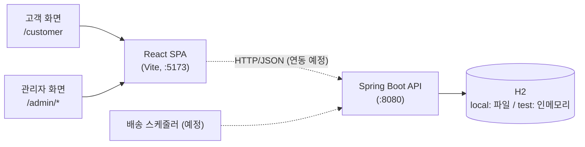
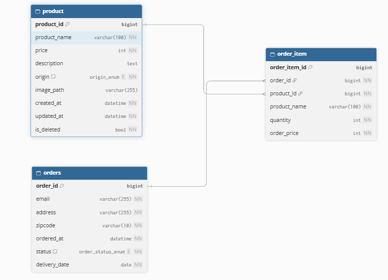

# ☕ 카페 원두 주문 서비스 (NBE14-16-1-team2)

회원가입 없이 이메일만으로 원두를 주문하고, 관리자가 상품과 주문·배송 상태를 관리하는 웹 서비스입니다.

> **현재 단계: 초기 개발 환경 세팅**
> 이 문서의 비즈니스 규칙·ERD·API 정책은 **후속 개발 기준**입니다.
> 지금까지 구현된 것은 [3. 주요 기능과 구현 현황](#3-주요-기능과-구현-현황)에서 ✅로 표시한 항목뿐입니다.

## 📌 목차

1. [프로젝트 소개](#1-프로젝트-소개)
2. [핵심 비즈니스 규칙](#2-핵심-비즈니스-규칙)
3. [주요 기능과 구현 현황](#3-주요-기능과-구현-현황)
4. [기술 스택](#4-기술-스택)
5. [시스템 구성](#5-시스템-구성)
6. [ERD 및 설계 의도](#6-erd-및-설계-의도)
7. [API·응답 정책](#7-api응답-정책)
8. [실제 프로젝트 구조](#8-실제-프로젝트-구조)
9. [팀 구성 및 역할](#9-팀-구성-및-역할)
10. [협업 규칙](#10-협업-규칙)
11. [일정](#11-일정)
12. [심화 과제](#12-심화-과제)
13. [실행·검증 방법](#13-실행검증-방법)
14. [남은 결정 사항](#14-남은-결정-사항)

---

## 1. 프로젝트 소개

| 항목 | 내용 |
|---|---|
| 서비스 | 카페 원두 온라인 주문 서비스 |
| 고객 | 회원가입 없이 이메일·주소·우편번호를 입력해 원두를 주문 |
| 관리자 | 원두 상품 등록·수정·삭제, 배송 그룹별 주문 확인 |
| 저장소 구성 | `backend/` (Spring Boot API 서버), `frontend/` (React SPA) |

> 문서 간 내용이 충돌하면 **최신 팀 확정 정책**을 우선합니다.

---

## 2. 핵심 비즈니스 규칙

> 아래 규칙은 팀 확정 정책이며 **아직 구현되지 않았습니다.** 미확정 부분은 [14. 남은 결정 사항](#14-남은-결정-사항)에 따로 적었습니다.

### 2-1. 고객 구분
- 회원가입·로그인 없이 **이메일**로 고객을 구분합니다.

### 2-2. 배송 그룹과 주문 병합
- 주문 시각(`ordered_at`)의 **오후 2시** 기준으로 배송 예정일(`delivery_date`)을 계산해 주문 시점에 저장합니다.
- 같은 고객(이메일)이 같은 배송 그룹에 넣은 주문은 병합 대상입니다.
- **주소가 다른 주문은 병합하지 않고 별도 주문**으로 저장합니다.

### 2-3. 주문 상태와 배송 스케줄러

```
ORDERED ──(매일 14:30, 배송 예정일이 오늘인 주문)──▶ SHIPPING ──(배송 시작일 다음 날 14:30)──▶ DELIVERED
   │
   └──▶ CANCELLED (ORDERED 상태에서만 전환 가능, 이후 상태 변경 없음)
```

| 상태 | 의미 | 전환 |
|---|---|---|
| `ORDERED` | 주문 접수 (기본값) | 주문 생성 시 |
| `SHIPPING` | 배송 중 | 매일 14:30 스케줄러가 `ORDERED`이면서 배송 예정일이 오늘인 주문을 일괄 전환 |
| `DELIVERED` | 배송 완료 | 배송 시작일 **다음 날 14:30** 스케줄러가 일괄 전환 |
| `CANCELLED` | 주문 취소 | `ORDERED` 상태에서만 가능 |

### 2-4. 취소 정책
- **고객의 주문 취소는 허용하지 않습니다.**
- **병합된 주문의 일부 상품만 취소하는 것은 허용하지 않습니다.**
- 관리자가 언제 주문을 수정·전체 취소할 수 있는지는 미확정입니다.

### 2-5. 상품 삭제와 주문 스냅샷
- 상품은 행을 지우지 않고 `is_deleted` 플래그로 **논리 삭제**합니다.
- 주문 상세(`order_item`)에는 **주문 당시 상품명과 단가**를 복사해 저장합니다. 이후 상품 이름이나 가격이 바뀌어도 과거 주문 내역은 변하지 않습니다.

### 2-6. 시간 기준
- 모든 시간 계산은 **Asia/Seoul** 기준입니다. (백엔드 JVM 기본 시간대와 Hibernate JDBC 시간대를 Asia/Seoul로 설정해 둠)

---

## 3. 주요 기능과 구현 현황

상태: ✅ 완료 · ⬜ 예정

### 환경 세팅 (이번 작업)

| 항목 | 상태 |
|---|---|
| Spring Boot 프로젝트 생성 (Java 21, Gradle Wrapper) | ✅ |
| JPA + H2 연결 (local: 파일 DB, test: 인메모리 DB) | ✅ |
| 테스트 전용 엔티티로 JPA 저장·조회 통합 테스트 | ✅ |
| `product` / `order` / `global` 패키지 골격 | ✅ |
| React + Vite 프로젝트 생성 | ✅ |
| 기본 라우팅 (`/customer`, `/admin/products`, `/admin/orders`, `/` → `/customer`, 404) | ✅ |
| 공통 레이아웃·내비게이션 | ✅ |

### 고객 기능

| 기능 | 상태 |
|---|---|
| 원두 상품 목록 조회 | ⬜ |
| 이메일·주소·우편번호로 주문 생성 | ⬜ |
| 배송 그룹 계산(오후 2시 기준)과 주문 병합 | ⬜ |

### 관리자 기능

| 기능 | 상태 |
|---|---|
| 상품 등록·수정·논리 삭제 | ⬜ |
| 주문 목록 조회 | ⬜ |
| 배송 상태 자동 전환 스케줄러 | ⬜ |
| 관리자 인증 | ⬜ (방식 미확정) |

### 공통

| 기능 | 상태 |
|---|---|
| 공통 예외 처리 (`code`/`message` 오류 본문) | ⬜ |
| CORS 설정 및 프론트·백엔드 API 연동 | ⬜ |

> ⚠️ 현재 `/admin/*` 화면은 **URL로 화면만 구분**할 뿐 인증·권한 검사가 없습니다. 누구나 접근할 수 있습니다.

---

## 4. 기술 스택

실제로 프로젝트에 적용된 버전입니다.

| 구분 | 기술 | 버전 |
|---|---|---|
| Language | Java | 21 (Gradle toolchain, 검증 환경: Eclipse Temurin 21.0.13) |
| Framework | Spring Boot | 4.2.0 (Spring Framework 7.1.0) |
| Build | Gradle Wrapper | 9.9.2 |
| ORM | Spring Data JPA / Hibernate ORM | 4.2.0 / 7.4.15.Final |
| Validation | Hibernate Validator | 9.1.6.Final |
| Database | H2 | 2.5.252 |
| 기타 | Lombok | 1.18.48 |
| Test | JUnit Jupiter (spring-boot-starter-*-test) | 6.1.3 |
| Frontend | React / React DOM | 19.3.1 |
| Build Tool | Vite (@vitejs/plugin-react) | 8.3.8 (6.3.0) |
| Routing | React Router (`react-router`) | 8.5.3 |
| Lint | oxlint | 1.95.0 |
| Runtime | Node.js | 22.22 이상 필요 (검증 환경: 26.13.0, npm 11.20.0) |

MySQL·Docker·Redis는 사용하지 않습니다.

---

## 5. 시스템 구성



| 계층 | 역할 |
|---|---|
| Controller | 요청 검증(Validation), 응답 변환 (예정) |
| Service | 배송 그룹 계산, 주문 병합, 상태 전환 등 비즈니스 규칙 (예정) |
| Repository | Spring Data JPA로 DB 접근 |
| DB | H2 (local 프로필은 `backend/data/`의 파일 DB) |

> 현재 프론트와 백엔드는 **연결되어 있지 않습니다.** (CORS·API 호출 미구현)

---

## 6. ERD 및 설계 의도

> 아래 테이블은 설계 기준이며, 이번 작업에서는 **실제 도메인 엔티티를 만들지 않았습니다.**



- `orders` 1:N `order_item` (`order_id` FK, 삭제 규칙 CASCADE)
- `product` 1:N `order_item` (`product_id` FK, 삭제 규칙 RESTRICT)

### product

| 컬럼 | 타입 | 제약 | 설명 |
|---|---|---|---|
| `product_id` | bigint | PK, 자동 증가 | 상품 ID |
| `product_name` | varchar(100) | 필수 | 상품 이름 |
| `price` | int | 필수 | 1개당 가격 (원 단위 정수) |
| `description` | text | | 상품 설명 |
| `origin` | enum | 필수 | `COLOMBIA`, `BRAZIL`, `ETHIOPIA`, `OTHER` |
| `image_path` | varchar(255) | | 이미지 경로 |
| `created_at` | datetime | 필수 | 생성일시 |
| `updated_at` | datetime | 필수 | 수정일시 |
| `is_deleted` | bool | 필수 | 논리 삭제 여부 |

### orders

| 컬럼 | 타입 | 제약 | 설명 |
|---|---|---|---|
| `order_id` | bigint | PK, 자동 증가 | 주문 ID |
| `email` | varchar(255) | 필수 | 고객 이메일 (고객 구분 기준) |
| `address` | varchar(255) | 필수 | 배송 주소 |
| `zipcode` | varchar(10) | 필수 | 우편번호 (앞자리 0 보존을 위해 문자열) |
| `ordered_at` | datetime | 필수 | 주문 시각 (오후 2시 기준 판단용) |
| `status` | enum | 필수, 기본 `ORDERED` | `ORDERED`, `SHIPPING`, `DELIVERED`, `CANCELLED` |
| `delivery_date` | date | 필수 | 배송 예정일 (주문 시점에 계산해 저장) |

### order_item

| 컬럼 | 타입 | 제약 | 설명 |
|---|---|---|---|
| `order_item_id` | bigint | PK, 자동 증가 | 주문 상세 ID |
| `order_id` | bigint | FK → `orders`, 필수 | 소속 주문 |
| `product_id` | bigint | FK → `product`, 필수 | 주문 상품 |
| `product_name` | varchar(100) | 필수 | **주문 당시** 상품 이름 |
| `quantity` | int | 필수 | 주문 수량 |
| `order_price` | int | 필수 | **주문 당시** 단가 |

### 설계 의도

- **테이블 이름 `orders`**: `ORDER`는 SQL 예약어라 복수형을 사용합니다.
- **주문 당시 값 스냅샷**: `order_item.product_name`, `order_price`를 따로 저장해 상품 정보가 바뀌어도 주문 내역이 유지됩니다.
- **배송 예정일 저장**: 오후 2시 기준 계산 결과를 `delivery_date`에 저장해, 배송 그룹 조회와 스케줄러 전환을 이 컬럼으로 처리합니다.
- **상품 논리 삭제**: `is_deleted`로 숨기고 행은 남겨, 과거 주문이 참조하는 상품을 보존합니다.

### 주문 취소 ≠ 주문 행 물리 삭제

| 구분 | 의미 | 데이터 변화 |
|---|---|---|
| **주문 취소** (업무 기능) | 주문 상태를 `CANCELLED`로 변경 | `orders`·`order_item` 행은 **그대로 남음** |
| **주문 행 물리 삭제** (DB 규칙) | `orders` 행을 `DELETE` | FK `ON DELETE CASCADE`로 해당 `order_item`도 함께 삭제 |

- 주문 취소는 행을 지우지 않습니다. CASCADE는 **데이터 정리 등으로 주문 행 자체를 지울 때만** 적용되는 물리 규칙입니다.
- `order_item.product_id`는 `ON DELETE RESTRICT`입니다. 주문에 쓰인 상품 행은 물리 삭제할 수 없으며, 상품 삭제 기능은 `is_deleted` 플래그로 처리합니다.

---

## 7. API·응답 정책

> 아래는 **응답 형식 정책**이며 아직 구현되지 않았습니다. 엔드포인트 목록은 API 확정 후 추가합니다.

- `success`/`data` 같은 **공통 래퍼 없이** HTTP 상태 코드와 실제 데이터를 그대로 반환합니다.
- 삭제 성공은 **`204 No Content`**, 본문 없음.
- JSON 필드명은 **camelCase**입니다.
- 오류 응답 본문은 `code`와 `message`만 사용합니다.

```json
{
  "code": "PRODUCT_NOT_FOUND",
  "message": "상품을 찾을 수 없습니다."
}
```

---

## 8. 실제 프로젝트 구조

```
.
├── .github/
│   └── pull_request_template.md
├── backend/
│   ├── build.gradle / settings.gradle
│   ├── gradlew / gradlew.bat / gradle/wrapper/   # Gradle Wrapper 9.9.2
│   ├── config/
│   │   └── local-db.properties.example           # 실제 local-db.properties 는 Git 제외
│   └── src/
│       ├── main/java/com/cafe/beanorder/
│       │   ├── BeanOrderApplication.java          # 시간대 Asia/Seoul 설정
│       │   ├── product/                            # 상품 도메인 (예정, package-info.java만 존재)
│       │   ├── order/                              # 주문 도메인 (예정)
│       │   └── global/                             # 공통 설정·예외 처리 (예정)
│       ├── main/resources/
│       │   ├── application.properties              # 기본 프로필 local, 포트 8080
│       │   └── application-local.properties        # H2 파일 DB, ddl-auto=update
│       └── test/
│           ├── java/com/cafe/beanorder/
│           │   ├── BeanOrderApplicationTests.java
│           │   └── global/dbcheck/                 # 테스트 전용 엔티티·Repository·통합 테스트
│           └── resources/application-test.properties  # H2 인메모리, ddl-auto=create-drop
├── docs/
│   └── images/erd.png                              # ERD 이미지
├── frontend/
│   ├── package.json / package-lock.json
│   ├── vite.config.js                              # 개발 서버 포트 5173 고정
│   └── src/
│       ├── main.jsx / App.jsx                      # BrowserRouter, 라우트 정의
│       ├── layouts/MainLayout.jsx                  # 공통 레이아웃·내비게이션
│       └── pages/
│           ├── CustomerPage.jsx                    # /customer
│           ├── NotFoundPage.jsx                    # 404
│           └── admin/
│               ├── AdminProductsPage.jsx           # /admin/products
│               └── AdminOrdersPage.jsx             # /admin/orders
├── .gitignore
└── README.md
```

---

## 9. 팀 구성 및 역할

> 팀원 이름·GitHub 계정·역할 분담은 아직 이 문서에 확정되지 않았습니다. 확정 후 채워 주세요.

| 이름 | GitHub | 백엔드 | 프론트엔드 |
|---|---|---|---|
| (미정) | (미정) | (미정) | (미정) |

---

## 10. 협업 규칙

### 브랜치 전략

| 브랜치 | 용도 |
|---|---|
| `main` | 배포·제출 기준 |
| `dev` | 개발 통합 브랜치, 모든 작업 PR의 대상 |
| `feature/{작업명}` | 기능·설정 작업 (예: `feature/project-setup`) |

- 작업 브랜치는 `dev`에서 만들고, `dev`로 PR을 엽니다.
- 머지는 통합 담당자가 리뷰 후 진행합니다. force push는 하지 않습니다.
- PR은 [.github/pull_request_template.md](.github/pull_request_template.md) 양식을 따릅니다.

### 커밋 메시지

`타입: 내용` 형식을 사용합니다.

| 타입 | 용도 |
|---|---|
| `feat` | 기능 추가 |
| `fix` | 버그 수정 |
| `refactor` | 동작 변경 없는 코드 개선 |
| `test` | 테스트 추가·수정 |
| `docs` | 문서 |
| `chore` | 빌드·설정·환경 |

### 이름 규칙

| 대상 | 규칙 | 예시 |
|---|---|---|
| 변수명, JSON 필드명 | camelCase | `deliveryDate`, `orderPrice` |
| 직접 작성하는 함수·메서드 | snake_case | `calculate_delivery_date()` |
| 클래스, React 컴포넌트 | PascalCase | `OrderService`, `AdminOrdersPage` |
| DB 컬럼 | ERD의 snake_case | `delivery_date`, `is_deleted` |

예외: React Hook(`useState` 등), 프레임워크 필수 메서드와 오버라이드(`main`, `toString` 등), Spring Data JPA 파생 쿼리 메서드(`findByEmail` 등)는 각 프레임워크 규칙을 따릅니다.

---

## 11. 일정

> 상세 일정은 팀 확정 후 작성합니다.

| 날짜 | 내용 | 상태 |
|---|---|---|
| 2026-11-26 | 초기 개발 환경 세팅 및 README 작성 | PR 리뷰 대기 |
| (미정) | 이후 일정 | 팀 확정 후 작성 |

---

## 12. 심화 과제

기본 기능을 끝낸 뒤 시간 여유가 있으면 진행할 후보입니다. 진행 여부와 범위는 미정입니다.

| 후보 | 내용 | 상태 |
|---|---|---|
| 상품 이미지 | `image_path`를 활용한 원두 이미지 등록·표시 | ⬜ 미정 |
| 통계 | 관리자용 판매 통계 | ⬜ 미정 |
| 배포 | 백엔드·프론트 외부 배포 | ⬜ 미정 |

---

## 13. 실행·검증 방법

### 필요 환경

- **Java 21** — 설치돼 있지 않으면 첫 빌드 때 Gradle toolchain(foojay resolver)이 자동으로 내려받습니다.
- **Node.js 22.22 이상** (react-router 8 요구 사항)

### 백엔드 (Windows PowerShell)

```powershell
cd backend
Copy-Item config\local-db.properties.example config\local-db.properties   # 최초 1회, 비밀번호 수정
.\gradlew.bat build     # 빌드 + 테스트 (test 프로필, H2 인메모리)
.\gradlew.bat bootRun   # local 프로필로 실행 (기본 프로필)
```

| 항목 | 값 |
|---|---|
| 접속 주소 | http://localhost:8080 (API가 아직 없어 `/`는 404가 정상) |
| H2 파일 위치 | `backend/data/bean-order.mv.db` (`backend` 폴더에서 실행 기준, Git 제외) |
| DB 비밀번호 | `backend/config/local-db.properties`의 `LOCAL_DB_PASSWORD` (Git 제외). H2 파일 DB는 처음 만들 때의 비밀번호로 고정됩니다. |

### 프론트엔드 (Windows PowerShell)

```powershell
cd frontend
npm install
npm run dev     # 개발 서버
npm run build   # 프로덕션 빌드 (frontend/dist)
```

| 경로 | 화면 |
|---|---|
| http://localhost:5173/ | `/customer`로 이동 |
| http://localhost:5173/customer | 고객 상품·주문 |
| http://localhost:5173/admin/products | 관리자 상품 관리 |
| http://localhost:5173/admin/orders | 관리자 주문 관리 |
| 그 외 경로 | 404 안내 |

포트 5173은 `strictPort`로 고정되어 있어, 사용 중이면 다른 포트로 넘어가지 않고 실행이 실패합니다.

### 환경 세팅 검증 결과 (2026-11-26, Windows 11)

| 항목 | 결과 |
|---|---|
| `gradlew.bat clean build` | 성공 |
| 테스트 (test 프로필, H2 인메모리) | 4개 통과 — 컨텍스트 로드, 인메모리 H2 연결, 테스트 엔티티 저장·조회, 시간대 Asia/Seoul |
| local 프로필 실행 | 포트 8080 기동, `jdbc:h2:file:./data/bean-order` 연결 |
| 검증용 엔티티 분리 | 앱 jar에 포함되지 않음, local DB에 `db_check` 테이블 없음 |
| `npm run build` / `npm run lint` | 성공 |
| 개발 서버 | 포트 5173 기동 |
| 라우팅 | 직접 URL 진입, 메뉴 이동, `/` → `/customer`, `/admin`·임의 경로 404 확인 |

---

## 14. 남은 결정 사항

| 항목 | 현재 상태 |
|---|---|
| 관리자 인증 방식 | **미확정** (현재 `/admin/*`는 화면 구분만, 인증 없음) |
| 관리자의 주문 수정·전체 취소 가능 시점 | **미확정** |
| 정확히 14:00:00에 접수한 주문의 배송 그룹 | **미확정** |
| 주문 병합 시 주소 비교에 우편번호 포함 여부와 공백 정규화 | **미확정** |
| 서버 중단으로 스케줄러 실행을 놓친 경우 처리 | **미확정** |
| 팀원 역할 분담·세부 일정 | 이 문서에 미반영 |
